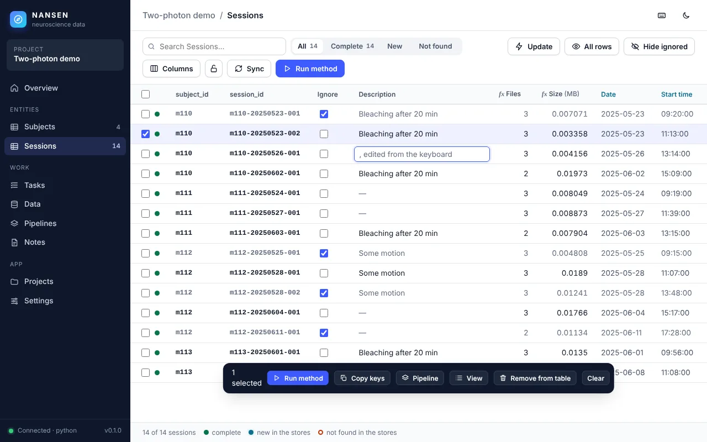
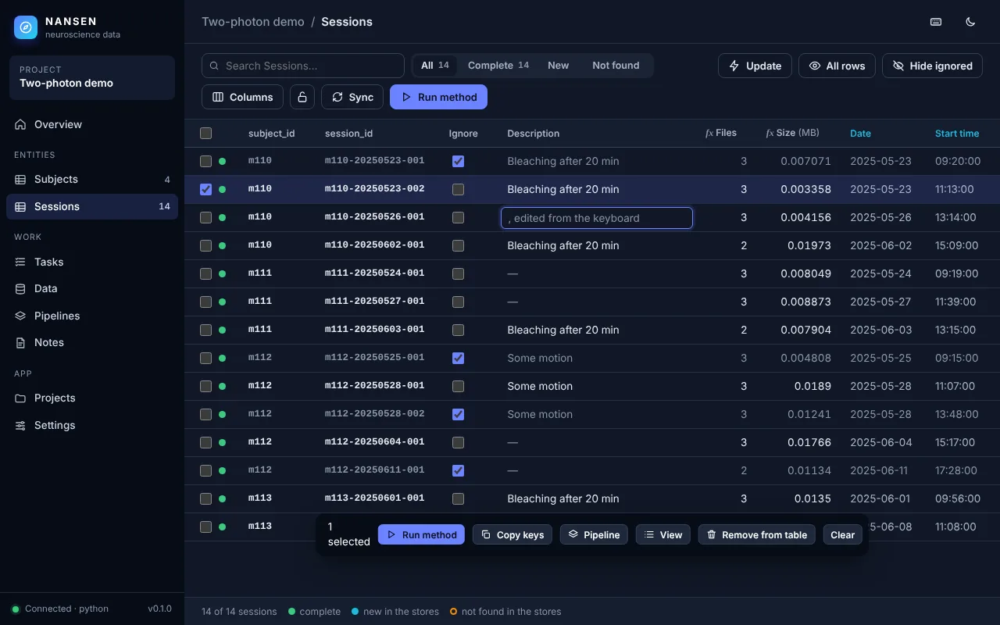
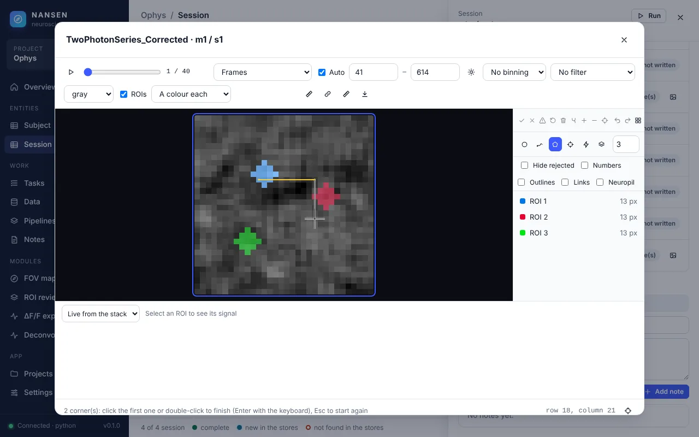
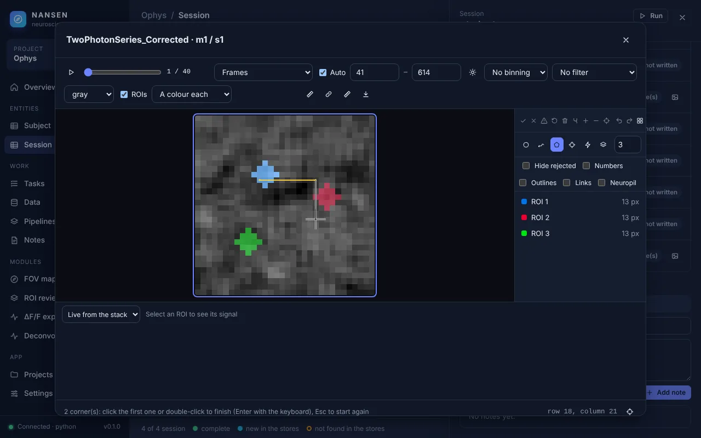

# The dashboard against a modern web UI

This page holds the dashboard (`ui/`, and the ophys module's pages in `modules/ophys/dashboard/`) to the standards of a modern web interface, and says how it measures up. Where a recognised standard exists, it is the measure: **WCAG 2.1 level AA**, checked with Deque's **axe-core** (the rules tagged `wcag2a`, `wcag2aa`, `wcag21a` and `wcag21aa`) on every page, menu and dialog, in both themes; WCAG's success criterion **2.1.1 Keyboard** (every function of the pointer operable from the keyboard), checked function by function; and Google's **Lighthouse** scores for performance, accessibility and best practices. The other criteria are stated below. Each result is a measurement or a pointer into the code, not an impression. The screenshots at the end were taken with Playwright and Chromium from the demo project (`nansen demo`) and, for the viewer pages, from the ophys conformance project after motion correction, ROI detection, signal extraction and session alignment, in the light and the dark theme.

## The standard and the results

| # | Criterion | Standard | Result |
|---|---|---|---|
| 1 | Responsive layout | No sideways scrolling of the page at 1024 px and at a phone's 390 px; the navigation stays reachable | **Pass** |
| 2 | Themes | Light and dark, following the system's setting, with a manual override | **Pass** |
| 3 | Accessibility | **WCAG 2.1 A and AA**, by axe-core 4.10's rules: names, roles and states of controls, lists, landmarks, contrast (4.5:1, 3:1 when large), ... on 71 views in each theme | **Pass**: 0 violations on 142 views, after the fixes below (was **fail**: 305 failing elements on the first 25 views alone; 6 rules in all) |
| 4 | Keyboard | **WCAG 2.1.1 Keyboard**: every function of the pointer also from the keyboard; every control reachable with Tab and its focus visible (2.4.7); Esc closes dialogs and menus | **Pass** after the fixes below (was **partial**: editing a cell, drawing an ROI, placing on the FOV map, measuring, moving and sizing columns, picking from lists needed the pointer) |
| 5 | Navigation | No full page loads between pages (hash routing); Back and Forward work | **Pass** |
| 6 | Live updates | The backend pushes changes; the page does not poll | **Pass** after the fix below (was **partial**: the Tasks page polled while a task was active) |
| 7 | Components | One set of buttons, dialogs, menus, toasts and a drawer, used everywhere | **Pass** |
| 8 | States | Loading, empty and error states that say what is going on and what to do | **Pass** after the fix below (was **partial**) |
| 9 | Large tables | 5,000 rows usable: a virtualized grid, first rows within about a second, sorting and searching without a stall | **Pass** |
| 10 | Offline | Nothing loaded from a CDN or another host at run time, no web fonts | **Pass** |
| 11 | Lighthouse | **Lighthouse 12.2** scores, desktop and mobile, on the overview and an entity table | Desktop **100 / 100 / 100** (performance, accessibility, best practices) on both pages; mobile **96 / 100 / 100**, after the fixes below (were 98 / 98–100 / 96 on the desktop and 73 / 98–100 / 96 on mobile) |

Besides these: no page logged a console error in either theme (`console-errors` was empty for all 14 views), and the same page runs in MATLAB's `uihtml` (`test_dashboard_talks_through_the_matlab_bridge` plays MATLAB's part).

## How it was measured

A Playwright script (Chromium 1194, headless, 1280 × 800 unless said otherwise) served the demo project and the ophys project with `nansen.server.serve`, opened each view and measured it in the page:

- **Accessibility (WCAG 2.1 AA)**: axe-core 4.10.0 injected into the page (`axe.run` with `runOnly` the tags `wcag2a`, `wcag2aa`, `wcag21a`, `wcag21aa`) on 71 views, each in the light and the dark scheme of the system: the overview, both entity tables (with a row selected), the column menu, the Columns menu, the Help menu, the saved views menu, the selection bar's pipeline menu, the drawer (with an entity's files opened in place and a note), the run dialog, the preview, the filter, column, computed column and column import dialogs, a confirmation and a prompt, the shortcuts; Tasks (finished, and queued with a task's options dialog), Pipelines and the pipeline editor, Data and its data variable, data location (forms and JSON), method, dev method and file adapter dialogs, Notes, Settings, Projects (the catalog, the welcome page with no project, and the new project, demo and shared project dialogs), the overview's project details, modules and session menus, a project without a dataset and the dataset wizard, the phone's sidebar; the stack viewer with ROIs (a tool on, the brightness panel, the export, find, link, add-ROIs and ROI group menus, the properties, find and video dialogs, the ROI gallery, a linked stack), the signal plot, the viewer and the signals of files viewed without a project, the FOV map (with its photo and note dialogs), the ROI review, the ΔF/F and deconvolution explorers.
- **Keyboard (WCAG 2.1.1)**: every handler of the pointer in `ui/js` and `modules/ophys/dashboard` (`click` on elements that are no buttons, `dblclick`, `mousedown` and drags, `wheel`, `contextmenu`, `dragstart`), each matched with its way from the keyboard (the table in section 4), each tried with the keyboard alone in a Playwright test. As before: 40 presses of Tab on the session table, recording the focused element and whether it shows an outline or a focus shadow; Esc on a dialog, the drawer and a menu.
- **Contrast** (besides axe's): every element with its own visible text in the viewport; its colour and its effective background (the background colours of its ancestors, composited, with the element's opacity applied to the text); the WCAG relative luminance ratio; the threshold 3:1 when the text is 24 px or 18.66 px bold, else 4.5:1. Disabled controls are left out, as WCAG allows. Text drawn on canvases (the image, the traces) is not text to the page and is not measured.
- **Responsive**: `document.documentElement.scrollWidth - innerWidth` on each page, at 1024 × 768 and at 390 × 844 (a phone, with touch).
- **Navigation**: a value set on `window`, then seven clicks in the sidebar; the value must survive and `performance.getEntriesByType('navigation')` must stay at one document load.
- **Live updates**: the requests the Tasks page makes over 10 s with a task queued and nothing happening, and how long a task file written by another process (a `TaskQueue` of its own on the same folder, telling no one: as a worker of the other language does) takes to show on the page.
- **Large tables**: projects of 5,000 and 20,000 sessions made with `Project.create`; the time of `entities.list`, the time from navigating to the table to its first rows, the rows in the DOM, the time to draw after a jump of the scroll position (20 jumps, each measured over two animation frames), sorting a numeric column and searching.
- **Offline**: every request to another host than the app's own aborted and recorded, on five pages.
- **Lighthouse**: Lighthouse 12.2.1 from npm, with the same Chromium (`CHROME_PATH`), headless, categories performance, accessibility and best practices, its desktop preset and its default mobile emulation (a mid-range phone on a throttled 4G network), on `#/overview` and `#/entities/session` of the demo project.

The checks that found failures are Playwright tests in `python/tests/test_ui.py`: `test_the_pages_and_dialogs_meet_wcag_21_aa_by_axe` (light and dark: 15 views of the demo project) and `test_the_viewer_fov_map_and_roi_review_meet_wcag_21_aa_by_axe` (the viewer, its gallery, the signal plot, the FOV map and the ROI review, in both themes) assert no axe violation, with axe-core vendored as `python/tests/axe.min.js` (MPL-2.0, its notice in the file and in `axe.min.js.LICENSE`) so they run offline; `test_a_table_is_moved_through_selected_and_edited_from_the_keyboard`, `test_rois_are_drawn_measured_and_selected_from_the_keyboard`, `test_the_fov_map_and_the_signal_plot_from_the_keyboard`, `test_menus_and_dialogs_work_from_the_keyboard` and `test_text_has_enough_contrast_in_either_theme` cover the keyboard and contrast; `test_the_tasks_page_follows_task_files_changed_on_disk_without_polling` the live updates.

## 1. Responsive layout: pass

| Width | Pages | Page wider than the window | Sidebar |
|---|---|---|---|
| 1024 px | overview, table, drawer, run dialog, tasks, pipelines, data, notes, settings, projects | 0 px on every page | shown |
| 390 px | the same 10 | 0 px on every page | behind the menu button |

Below 860 px the sidebar slides in over the page from a menu button in the top bar (`ui/css/app.css` `@media (max-width: 860px)`, `ui/js/app.js` `menu-button`; `test_a_narrow_window_has_the_sidebar_behind_a_menu`). Two-column cards fall to one column below 1100 px, forms below 600 to 760 px. The entity table keeps its columns and scrolls sideways inside its own frame, as a spreadsheet does; the page itself does not move. The image viewer and the FOV map are usable on a tablet but cramped on a phone, which is not a target for them.

  

## 2. Themes: pass

The colours are tokens on `:root` (`ui/css/app.css`), redefined under `@media (prefers-color-scheme: dark)` and again under `:root[data-theme="dark"]`, with `color-scheme` set, so form controls and scrollbars follow. Emulating the system's scheme gave a body background of `rgb(246, 247, 249)` in light and `rgb(11, 16, 32)` in dark with no `data-theme` set. Settings has a theme choice (Follow the system, Light, Dark) kept per browser (`ui/js/app.js` `applyTheme`; `test_settings_page` checks the dark choice). The module pages use the same tokens. Every view below is shown in both.

## 3. Accessibility, WCAG 2.1 AA by axe-core: pass after fixing

axe-core checks what can be checked by machine of WCAG 2.1 A and AA: every control has a name, roles have the children and parents they need, lists hold list items, ARIA attributes are valid, scrolled regions are reachable, text has its contrast, and more (it cannot judge, say, whether a name is apt; a person still has to). The first run, on 25 views in the light theme, failed **305 elements under 4 rules**; the run over all 71 views found 2 more:

| Rule (WCAG) | What failed | Where |
|---|---|---|
| `label` (1.3.1, 4.1.2) | Inputs with no name | Every row's tick box and yes/no cells of the tables (29 per table), the Settings switches, the viewer's frame slider and contrast limits, the fields of forms (`div.field`: the label beside its input was not tied to it), the data locations' roots, file patterns and naming rules, the dataset config's text |
| `select-name` (4.1.2) | Lists to choose from with no name | The run dialog's preset, Settings' lists, the viewer's mode, signal, ROI variable and gallery order, the pipeline editor's steps and rules, the data locations' lists |
| `aria-required-children` (1.3.1) | A `role="menu"` holding inputs | The Columns menu and the viewer's ROI groups (a tick box per column or group) |
| `scrollable-region-focusable` (2.1.1) | A scrolled region the keyboard cannot reach | A dialog body with nothing focusable in it (the shortcuts) |
| `list` (1.3.1) | A list holding lists | A folder opened in place in the drawer's file tree, and an HDF5 file's contents |
| `color-contrast` (1.4.3) | 3.3:1 | "None yet" on the sidebar, for a project with no entity types |

The fixes: a field's label names its control, in one place (`ui/js/util.js` `labelField`, run by `N.h` for every `div.field`: the label's `for`); the other controls get an `aria-label` or a `title` saying what they are (a row's tick box "Select m110 / m110-20250523-001", a yes/no cell "Ignore of …", a step "Step 2: preset", a root "Root 1: path"); a box among a menu's items is a `menuitemcheckbox` that takes the keys, its box hidden and drawn as a mark (`components.js` `checkItem`); a dialog body with nothing to focus is focusable itself; a folder's contents opened in place are a list in an item of their own (`li.subtree`); "None yet" uses the sidebar's muted colour. And beyond axe's rules: the table is a `role="grid"` named by its entity type, with `aria-rowcount`, `aria-rowindex` and `aria-selected`; the drawer is a non-modal dialog named by its title, and hidden once closed (it slid out of view but stayed in the reading and Tab order); tool buttons say whether they are on (`aria-pressed`); a task's title and a mark's name are buttons, a card of the overview a link.

After them: **0 violations on all 71 views in either theme** (142 runs). Two Playwright tests keep it so (`test_the_pages_and_dialogs_meet_wcag_21_aa_by_axe` on 15 views of the demo project, light and dark, and `test_the_viewer_fov_map_and_roi_review_meet_wcag_21_aa_by_axe` on the viewer, its gallery, the signal plot, the FOV map and the ROI review), with axe-core vendored, so they run offline in CI.

### Contrast

The first measurement of contrast (before axe; the script below, still a test) found text below AA in both themes, the same few styles on every page (32 distinct failing styles in light, 34 in dark):

| Where | Light | Dark |
|---|---|---|
| The sidebar's muted text: section names, counts, the footer, "Project" | 3.07–3.75 | 3.61–4.13 |
| Muted text on a selected row or on a chip (keys of ignored rows, counts, units) | 4.42–4.48 | 4.11–4.33 |
| Green status pills ("complete", "completed", "available") | 3.55 | pass |
| White text on primary buttons ("Run method", "Add to queue", "Open") | pass | 3.31 |

The fix changes tokens only (`ui/css/app.css`): `--sidebar-muted` `#64748b` → `#8b9ab0`; `--text-3` `#667085` → `#5f6b7e` (light) and `#7c889b` → `#8a95a8` (dark); `--good` `#079455` → `#067647` and `--bad` `#d92d20` → `#c4271b` (light; its red pill computes to 4.44, though none was on screen); and a new `--on-accent` for text on accent backgrounds, white in light and `#0b1020` in dark, used by primary buttons and the active tool buttons of the viewer, the signal plot and the FOV map. The look is unchanged apart from slightly stronger secondary text.

After it: **0 failures among 1,403 text elements per theme**, on 14 views (overview, table, drawer, run dialog, tasks, pipelines, data, notes, settings, projects, viewer, signals, FOV map, ROI review). The lowest ratio left is 4.8.

## 4. Keyboard, WCAG 2.1.1: pass after fixing

### Every function of the pointer

WCAG 2.1.1 asks that everything the pointer does can be done from the keyboard, with no timing. Every pointer handler of the dashboard was listed (section "How it was measured") and matched with a way from the keyboard; those that had none got one:

| With the pointer | From the keyboard | Where |
|---|---|---|
| Click a cell to edit it; click elsewhere to save | The table is a grid (WAI-ARIA's grid pattern): one cell in the Tab order; the arrows, Home, End, Page Up and Page Down move (Ctrl + Home and End: the first and last row); **Enter or F2 edits** the cell, Enter saves, **Esc cancels**, **Tab saves and goes on** to the next cell (Shift + Tab the one before); a list of choices changes with the arrows and is saved with Enter | `entitygrid.js` `cellKey`, `edit` |
| Tick a yes/no cell or a row's box; Shift + click a range | **Space** ticks a yes/no cell, or selects the row; Shift + Space a range | `entitygrid.js` `cellKey` |
| Click a row to open its drawer; double-click a cell to run its column's action | Enter on a cell that cannot be edited: the action, the link, or the drawer, which then takes the focus and gives it back to the cell when Esc closes it | `entitygrid.js`, `components.js` `N.drawer.focus` |
| Click a header to sort it; drag a header to move a column; drag its edge to size it, double-click to fit | The column's menu (⋮, reached with Tab): Sort, and new: **Move left, Move right, Wider, Narrower, Fit the width** | `views.js` `columnMenu`, `entitygrid.js` `moveColumnBy`, `sizeColumnBy` |
| Click on the image with the round ROI or Detect tool | A tool's button pressed from the keyboard puts the focus on the image and shows a **cursor**: the arrows move it a pixel (Shift: 5), **Space or Enter** adds a round ROI there or detects the cell around it | `viewer.js` `cursorKey`, `actAtCursor` |
| Click the corners of a polygon, double-click to close it; drag around a cell freehand | With the Polygon or Freehand tool: Space places a corner at the cursor, **Enter closes** the outline, Esc starts again | `viewer.js` `addCorner`, `finishPolygon` |
| Drag across the image to measure | With the ruler: Space at one end, the arrows, Space at the other; the length shows as the cursor moves | `viewer.js` `actAtCursor` |
| Click an ROI on the image; Ctrl + click more; Shift + drag a rectangle | j and k (as before); **Shift + J, Shift + K** add the next or the one before; **Ctrl + A** selects every ROI shown; the ROI list is a listbox (Tab reaches it: ↑ ↓ pick, Ctrl + ↑ ↓ move, Ctrl + Space adds) | `viewer.js` `roiKey`, `components.js` `N.listbox` |
| Drag an ROI; drag to pan; the wheel or a double-click to zoom | The arrows move the selected ROIs; Alt + arrows pan; z, Shift + Z, Shift + 0 zoom (all as before) | `viewer.js` `roiKey`, `viewerKey` |
| Click an ROI, a column or a session in a list (the signal plot, the FOV map, the data locations) | Listboxes: ↑ ↓, Home, End pick; Ctrl + Space and Shift + ↓ add | `components.js` `N.listbox`, `N.option` |
| Drag across a signal plot to zoom, double-click for all frames, click to go to a frame; drag to mark an event | The plot takes the focus: ← → move its cursor (Shift: a tenth), **+ and −** zoom around it, **0** shows all, Enter goes to the frame; while marking, Space at the start and at the end | `traces.js` `N.tracePlot` |
| Click on the FOV map to place an FOV, a window, an injection or a note, or to select an FOV; click a mark to edit it | The map takes the focus: the arrows move a **cursor** (0.1 mm; Shift: 0.5 mm), Enter or Space does what a click there does | `fovmap.js` `clickAt` |
| Drag a mark on the FOV map | Its form has its **AP and ML**; a mark's name in the list is a button that opens it | `fovmap.js` `markForm` |
| Double-click a crop in the ROI review to edit it in that session | The crops of the selected ROI are buttons (in the Tab order); **Enter** opens it; the arrows take the keyboard along to the next ROI | `roireview.js` |
| Click a task, a card of the overview, a recent task | A task's title, a recent task's title are a button and a link; a card is a link | `views.js` |
| Click the dimmed page to close the sidebar on a phone | Esc | `app.js` `bindShortcuts` |

A keyboard press that answers a dialog (Enter in a prompt or a mark's form) no longer also presses the button the focus goes back to (it opened the dialog again). The shortcuts dialog (`?`) lists all of these. Three Playwright tests do each with the keyboard alone: `test_a_table_is_moved_through_selected_and_edited_from_the_keyboard` (the grid, the column menu, the drawer, a card of the overview, a task), `test_rois_are_drawn_measured_and_selected_from_the_keyboard` (a round ROI, a polygon, a measurement, Ctrl + A, Shift + J, the ROI list) and `test_the_fov_map_and_the_signal_plot_from_the_keyboard` (a session picked in its listbox, an FOV placed at the cursor, a note added and moved, the plot's cursor, zoom and list).

 

The session table from the keyboard: a row selected with Space, a cell being edited after Enter.

 

A polygon drawn from the keyboard: two corners placed with Space, the cursor (the cross) on the way to the third.

### Reaching every control

What worked: all 40 Tab stops on the table page showed a focus ring (the browser's, or the inputs' accent shadow); Esc closed dialogs and the drawer and left the search box; `?` lists the shortcuts, `/` searches, `g` then a letter or a number goes to a page or a table, and `w` sends the selected rows to the workspace, as dev's key (`ui/js/app.js` `bindShortcuts`; `test_lock_editing_and_keyboard_shortcuts`, `test_send_the_selection_to_the_workspace`); the keys also work with the focus on a row's tick box. The viewer has imviewer's and roimanager's keys (`ui/js/viewer.js` `viewerKey`, `roiKey`).

What did not:

- A column's menu button was `visibility: hidden` until the header was hovered, so Tab never reached it: no column menu (sort, filter, hide, reset, remove) from the keyboard.
- Menu items were plain `div`s: not focusable, no arrow keys, and Esc did not close a menu.
- A dialog took no focus and did not keep it: Tab went on into the page behind it. It had no `role="dialog"`.
- An entity's drawer opened only with a click on its row.
- Toasts were not announced to screen readers.

The fix (`ui/js/components.js`, `ui/js/entitygrid.js`, `ui/css/app.css`, `ui/index.html`): the column menu button is transparent instead of hidden, so it is reachable and shows when focused; a menu (`role="menu"`) focuses its first item, the arrows, Home and End move, Enter or Space picks, Esc or Tab close it and give the focus back to its button, and Esc closes only the menu, not a dialog under it; a dialog has `role="dialog"`, `aria-modal` and `aria-labelledby`, takes the focus when it opens (itself, so a viewer's keys keep working), keeps Tab and Shift+Tab inside it, and gives the focus back when it closes; Enter on a row's key cell opens its drawer; the toasts are a polite live region. Measured again: menus open from the keyboard with the focus inside, Esc closes them, the focus stays in a dialog through 30 presses of Tab, and the full Playwright suite still passes.

The gaps that measurement left (a cell edited only after a click, ROIs drawn only with the pointer) are closed by the keyboard's ways above. Every control those add shows its focus: the grid's cell, the image, the plot and the map an accent ring; the crops, the tree's folders and the actions of a file (shown on hover, and now when focused too) an outline.

## 5. Navigation: pass

Pages are `#/…` routes rendered in place (`ui/js/app.js`: a `hashchange` listener and `render`). After seven clicks in the sidebar the value set on `window` was still there, the document had been loaded once, and Back went to the previous page. A view whose data arrives after the user has moved on does not draw over the new page (`app.js` `render`).

## 6. Live updates: pass after fixing

The backend pushes events: rows, notes, views, pipelines, scans, task changes and task log lines (`docs/reference/protocol.md`, Events). Python sends them as server-sent events (`/events`, `ui/js/transport.js` `EventSource`), MATLAB as `uihtml` events. With nothing running, the Tasks page made no requests in 10 s, and a task queued through this app appeared 20–60 ms later (four runs). The table, the notes, the drawer and the task log follow events in the same way.

The gap this had: while a task was queued or running, the Tasks page read `tasks.list` and `queue.status` every 1.5 s (14 requests in 6 s), because a worker of the other language, a headless worker (`nansen worker`) or another process writes the task files without sending this app any event. Now the backend watches the tasks folder instead, and the page only listens:

- The app that serves the dashboard watches its project's `tasks` folder: Python's server (`AppServer` turns on `Api.watch`; a thread) and MATLAB's `nansen.App` (`nansen.Api.watch`; a `timer`). Every 0.5 s `TaskQueue.poll_changes` (Python) and `TaskQueue.pollChanges` (MATLAB) stat the task files: their modification time and size, and in Python their inode, since a file is replaced atomically. Only a file that changed is read. A task whose document differs from the one last sent goes out as a `task` event, a file that is gone as `removed`; changes the app made itself were sent when it made them and are not sent again. MATLAB's dates can be as coarse as a second, so it also reads again a file changed within the last two seconds and compares its text.
- The page has no timer left (`ui/js/views.js` tasks), and takes `removed` from others too.
- MATLAB's own background worker (`backgroundPool`) writes its tasks' progress to their files, which reached the page only when the task finished; it now shows as the task runs.

Measured: with a task queued, the Tasks page made **no requests in 10 s**; a task queued by another process appeared **94–821 ms** later, and one run by another process showed as completed **218–826 ms** later (seven changes, with another browser test running on the machine): within one look at the folder (0.5 s) and the page drawing it. Tested in Python (`test_changes_others_make_to_the_task_files_are_reported`, `test_a_watched_folder_reports_changes_on_its_own`, `test_the_served_app_watches_the_task_folder`), in MATLAB (`TasksTest/changesOthersMakeToTheTaskFilesAreReported`, `TasksTest/aWatchedFolderReportsChangesOnItsOwn`) and in the browser (`test_the_tasks_page_follows_task_files_changed_on_disk_without_polling`: no request in 3 s with a task queued; a task queued, run and removed by another queue shows on the page).

## 7. Components: pass

One set, in `ui/js/components.js` and `ui/css/app.css`: `N.toast`, `N.showError`, `N.dialog` (with `N.confirm` and `N.prompt`), `N.menu`, `N.drawer`, `N.statusPill`, and the classes `.btn` (`.primary`, `.ghost`, `.small`, `.icon`, `.danger`), `.chip`, `.pill`, `.card`, `.input`, `.switch`; icons are inline SVG (`N.icon`); options forms are drawn from the methods' JSON Schema (`ui/js/schemaform.js`). The module pages use the same `N` functions and tokens; the FOV map and the explorers add a few rules of their own for their layouts.

## 8. States: pass after fixing

- **Loading**: "Connecting…" before the backend answers, and "Cannot reach the NANSEN core" with the reason if it does not (`ui/js/app.js`); "Loading…" in the viewer, the signal plot and the add-on list. A page that takes more than 150 ms to load its data shows a bar sliding under the top bar (`.page-loading`, `role="progressbar"`, "Loading the page"; a still bar with reduced motion) and marks the page shown until then busy (`aria-busy="true"`) and dimmed; both go when the new page is drawn (`ui/js/app.js` `showLoading`, called from `render`). A quick page does not flicker.
- **Empty**: each list says what is missing and what to do: no tasks ("Select entities in a table and run a method"), no pipelines, no notes, no projects, a table with no rows ("No entities yet. Scan the stores, then sync."), a search with no match ("No rows match the filter."), an unknown table ("No entity type nosuchtype").
- **Errors**: a toast with the title of what failed, the protocol's error code and its message (`N.showError`), for every request a page makes.

The gap this had: a page waits for its data before it draws, and the previous page stayed until then with no sign of it; opening a table of 20,000 rows takes 2.4 to 3 s. Now the bar shows from 150 ms on. `test_a_page_says_it_is_loading_while_it_waits_for_its_data` holds `entities.list` back by 1.2 s and checks the bar and `aria-busy` while the table loads, and that both are gone once its rows are drawn.

 

## 9. Large tables: pass

The grid draws only the rows in view and ten above and below, with spacer rows for the rest (`ui/js/entitygrid.js` `renderBody`).

| Rows | `entities.list` | Navigation to first rows | Rows in the DOM | Draw after a scroll jump (median; max) | Sort | Search |
|---|---|---|---|---|---|---|
| 5,000 | 0.26–0.31 s | 0.91–0.92 s | 28 | 33 ms; 39–50 ms | 0.06–0.07 s | 0.14 s |
| 20,000 | 1.09–1.18 s | 2.4–3.0 s | 28 | 33–46 ms; 39–68 ms | 0.06–0.09 s | 0.14–0.15 s |

The ranges are over four runs on the same machine. A draw is measured over two animation frames, so 33 ms is the floor at 60 Hz: at 5,000 rows scrolling costs nothing beyond the frame. Most of the time to the first rows is the backend listing the rows and the JSON between them; the [architecture](architecture.md#open-questions) notes paging `entities.list` for hundreds of thousands of entities.

## 10. Offline: pass

With every request to another host aborted, the overview, the table, tasks, data and settings loaded and worked, and **no request to another host was attempted**. There are no web fonts (the stylesheet uses the system's fonts) and no CDN: `ui/index.html` loads the app's own scripts in order, with no build step, so the same files work from MATLAB's `uihtml`. The only addresses outside the app are the Help menu's pages, which open in the system's browser (`app.openUrl`). The tab's icon is inline too (a `data:` SVG).

## 11. Lighthouse: pass after fixing

Lighthouse 12.2.1 (`npm install lighthouse`, with the same Chromium), on the demo project's overview and session table:

| Page | Form factor | Performance | Accessibility | Best practices | First contentful paint | Largest contentful paint | Total blocking time | Layout shift |
|---|---|---|---|---|---|---|---|---|
| Overview | desktop | **100** (was 98) | **100** (was 98) | **100** (was 96) | 0.4 s | 0.6 s | 0 ms | 0 |
| Overview | mobile | **96** (was 73) | **100** (was 98) | **100** (was 96) | 2.1 s | 2.5 s | 0 ms | 0 |
| Sessions | desktop | **100** (was 98) | **100** | **100** (was 96) | 0.4 s | 0.5 s | 0 ms | 0 |
| Sessions | mobile | **96** (was 73) | **100** | **100** (was 96) | 2.0 s | 2.3 s | 0 ms | 0 |

What the first run found, and the fixes:

- **Best practices**: a console error, the browser's request for `/favicon.ico` (404). The page now has its icon inline.
- **Accessibility**: heading levels that skip (the page's `h1`, then its cards' `h3`): a page's sections are now `h2` (the same size), a dialog's stay `h3` under its `h2` title.
- **Performance** (on mobile, a throttled phone, 73: the first paint at 4.2 s): the scripts and the stylesheet (550 KB) were sent uncompressed. Python's server now gzips them for a browser that asks (`Accept-Encoding`; 162 KB in all, `test_the_frontend_is_compressed_for_a_browser_that_takes_it`).

What is left, by choice: the scripts are not minified and some of each is not used on a given page (there is no build step, so the same files load in MATLAB's `uihtml`; gzip takes most of the saving); the answers of `POST /api` are not compressed (they come from this machine); and a page is not kept in the back/forward cache, since its responses are `no-store` and it holds the event stream open.

## Screenshots

Light on the left, dark on the right. The pages look as before this work (headings are `h2` at the same size; the focus rings show only from the keyboard); the keyboard's new ways are in section 4.

**Overview**

 

**An entity table** (sessions)

 

**An entity's drawer**: values, locations, files, data variables, pipeline, notes

 

**The run dialog**: methods by category, presets, options from the method's schema, preview, run now or queue

 

**Tasks**: the queue, a task's details and log

 

**Pipelines**

 

**Data**: locations, data variables, fragments, methods

 

**Notes**

 

**Settings**

 

**Projects**

 

**The stack viewer with ROIs**: the mean image, the ROI list and tools, the selected ROI's ΔF/F

 

**The signal plot**

 

**The FOV map** (ophys module): the atlas, a FOV with its average image and ROIs

 

**ROI review** (ophys module): each ROI in every aligned session

 
